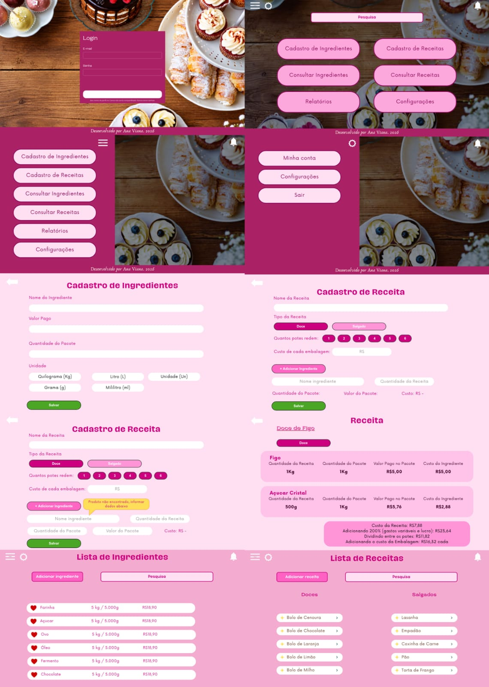

# 🍰 Gestão de Custos e Precificação de Receitas

  
  

  <strong>Transformando ingredientes em receitas lucrativas! ♡</strong>
   
  Um sistema desenvolvido para facilitar o cálculo de custos e a precificação de receitas culinárias.

---

## 🎀 Sobre o projeto

O sistema **Gestão de Custos e Precificação de Receitas** foi desenvolvido com o objetivo de simplificar o controle dos custos de produção de receitas, ajudando a entender quanto cada preparo custa e qual valor pode ser cobrado pelo produto final.

Com uma interface intuitiva e uma identidade visual delicada, o sistema permite cadastrar receitas, registrar ingredientes e visualizar os custos envolvidos na produção, auxiliando na organização financeira e na tomada de decisões.

## ✨ Funcionalidades

- 🧁 **Cadastro de receitas:** registre receitas doces e salgadas.
- 🥣 **Gerenciamento de ingredientes:** informe os ingredientes utilizados e suas respectivas quantidades.
- ⚖️ **Conversão de custos:** calcule o custo proporcional dos ingredientes de acordo com a quantidade utilizada e o valor e tamanho do pacote comprado.
- 📦 **Custo das embalagens:** considere o valor das embalagens no custo final do produto.
- 💰 **Precificação:** estime o preço de venda considerando os custos, os gastos variáveis e o lucro desejado.
- 🍮 **Custo por unidade:** divida o custo da receita pela quantidade de potes produzidos para calcular o custo individual.

## 🎨 Identidade visual

O projeto possui uma interface inspirada em uma estética delicada, moderna e relacionada ao universo da confeitaria.

| Elemento | Cor |
|---|---|
| Rosa principal | `#AA2165` |
| Estilo | Delicado e minimalista |
| Conceito | Culinária, organização e gestão |

## 🧮 Como funciona a precificação?

O sistema considera diferentes fatores para chegar ao preço final de uma receita.

**Exemplo ilustrativo:**

| Descrição | Valor |
|---|---:|
| Custo dos ingredientes | R$ 7,88 |
| Custo com acréscimo de 200% | R$ 23,64 |
| Quantidade produzida | 2 potes |
| Custo por pote com embalagem | R$ 16,32 |

O cálculo ajuda a visualizar os custos envolvidos na produção e a estimar um preço de venda que considere os gastos e a margem desejada.

## 🛠️ Tecnologias utilizadas

- HTML5 — estrutura das páginas.
- CSS3 — estilização e identidade visual.

## 📸 Prévia do projeto

  

## 🎯 Objetivo

Este projeto também representa uma oportunidade de aplicar conhecimentos de desenvolvimento web, lógica de programação e organização de dados na criação de uma solução prática para o controle de custos culinários.

---

  Desenvolvido por <strong>Ana Viana</strong>
   
  2026 · Projeto de desenvolvimento web

